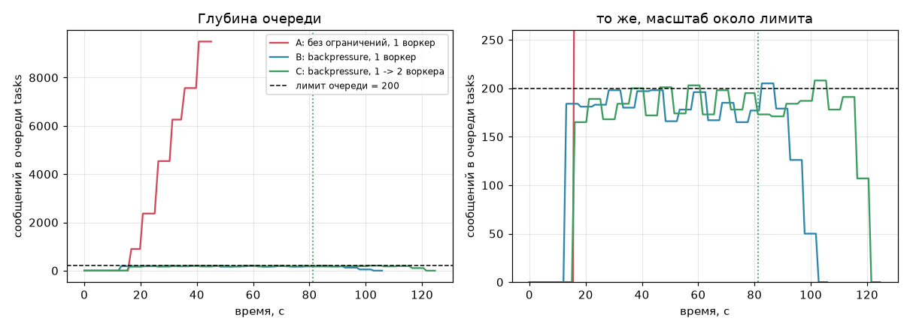
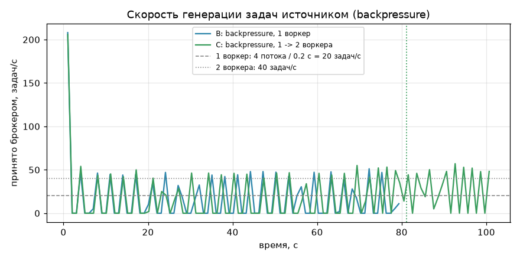
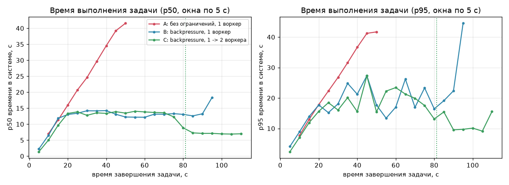
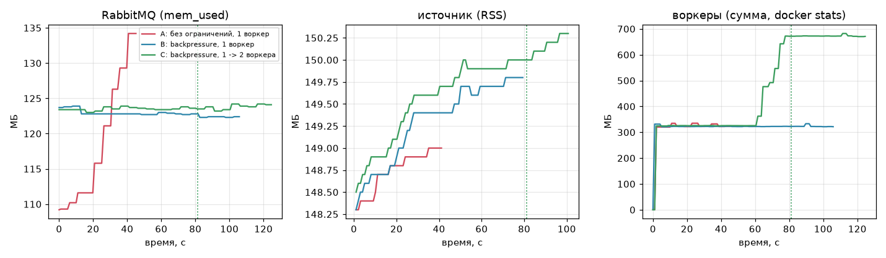

# edu-graphrag

[](https://github.com/newpotatato/edu-graphrag/actions/workflows/ci.yml)
[](https://github.com/newpotatato/edu-graphrag/actions/workflows/cd.yml)

Мультимодальный GraphRAG-агрегатор учебных материалов (PDF, презентации, видеолекции, код)
с общим графом курса (EduKG) и персональным графом знаний студента (PKG).

Сейчас в репозитории — каркас сервиса: асинхронное API, подключение к PostgreSQL и Neo4j,
тесты, Docker-образ и CI/CD, публикующий версионированный образ в GitHub Container Registry;
ML-пайплайн на MLflow: датасет → эксперименты → Model Registry → `POST /api/v1/process`
(подробно — [docs/mlflow.md](docs/mlflow.md)).

**Стек:** Python 3.12 · FastAPI · SQLAlchemy 2 (asyncpg) + Alembic · Neo4j async driver ·
structlog · uv · ruff · mypy · pytest · Docker · GitHub Actions · GHCR ·
MLflow 3 (Postgres + SeaweedFS S3) · scikit-learn · BM25

---

## Быстрый старт

Нужны [uv](https://docs.astral.sh/uv/), Docker и [just](https://github.com/casey/just)
(`winget install Casey.Just` / `brew install just`).

```bash
just setup        # uv sync + установка pre-commit хуков
just env          # .env из .env.example -> впишите POSTGRES_PASSWORD и NEO4J_PASSWORD
just up           # собрать образ и поднять app + postgres + neo4j, дождаться healthy
just smoke        # дёрнуть все эндпоинты
```

Без just: `uv sync && cp .env.example .env && docker compose up --build -d --wait`.

Все команды — `just` (без аргументов):

| Команда | Что делает |
|---|---|
| `just lint` | ruff check + ruff format --check + mypy (как в CI) |
| `just fmt` | отформатировать и применить безопасные автофиксы |
| `just test` | unit-тесты с coverage |
| `just test-integration` | + интеграционные с реальными БД (нужен `just up`) |
| `just up` / `down` / `clean` | поднять / остановить / остановить и удалить данные |
| `just logs [service]` | логи сервиса |
| `just migrate` | `alembic upgrade head` в контейнере |
| `just release [patch\|minor\|major]` | поднять версию, закоммитить, тегнуть, запушить → CD |

Swagger UI: <http://localhost:8000/docs>, Neo4j Browser: <http://localhost:7474>.

---

## Эндпоинты

| Метод и путь | Назначение |
|---|---|
| `GET /healthz` | liveness: процесс жив и отвечает. **Не ходит в БД** |
| `GET /api/v1/version` | версия приложения и коммит, из которого собран образ |
| `GET /api/v1/health` | end-to-end проверка: версия и время ответа каждого компонента (вкл. модель из MLflow) |
| `POST /api/v1/process` | инференс моделью из MLflow Model Registry, загруженной при старте |
| `GET /api/v1/model` | какая версия модели обслуживается (name, alias, version, run_id) |

```jsonc
// GET /api/v1/health -> 200, или 503 если хоть что-то лежит (тело то же, с причиной)
{
  "status": "ok",
  "components": [
    {"name": "postgres", "status": "up", "version": "17.11",   "latency_ms": 11.8, "error": null},
    {"name": "neo4j",    "status": "up", "version": "5.26.31", "latency_ms": 53.9, "error": null}
  ]
}
```

**Почему `/healthz` без `/api/v1`.** Это инфраструктурный контракт, а не публичное API: его
дёргают Docker healthcheck, Kubernetes-пробы и балансировщики, и путь не должен меняться при
выходе `/api/v2`. Он не проверяет БД намеренно: при падении БД оркестратор не должен
перезапускать здоровое приложение. Зависимости проверяет `/api/v1/health`.

**Версия приложения ≠ версия API.** `v1` — версия контракта API. Версия приложения берётся из
**одного места** — `project.version` в `pyproject.toml` — через метаданные установленного пакета
(`importlib.metadata`). Её же видят OpenAPI (`/docs`) и метки образа. CD не опубликует образ,
если git-тег не совпадает с `pyproject.toml` или запущенный образ отдаёт другую версию.

**`/api/v1/health`**: проверки идут параллельно (`asyncio.gather`), у каждой свой таймаут
(`HEALTH_CHECK_TIMEOUT`), время меряется `time.perf_counter()`. Ошибка одного компонента
не роняет ответ — она попадает в поле `error`. Используются пулы, созданные при старте, а не
новое подключение на каждый запрос.

---

## Структура

```
src/edu_graphrag/
  __init__.py          # __version__ из метаданных пакета
  main.py              # create_app(): lifespan, middleware, роутеры
  config.py            # Settings (pydantic-settings), всё из env / .env
  logging_config.py    # structlog: JSON в stdout, stdlib-логгеры через тот же формат
  middleware.py        # X-Request-ID + одна access-строка лога на запрос
  schemas.py           # pydantic-модели ответов
  api/
    system.py          # /healthz
    deps.py            # зависимости FastAPI (settings, components)
    v1/                # /api/v1/version, /api/v1/health
  components/          # внешние зависимости за общим протоколом Component
    base.py            #   startup / shutdown / fetch_version
    postgres.py        #   SQLAlchemy async engine (asyncpg)
    neo4j.py           #   neo4j AsyncDriver
    registry.py        #   какие компоненты есть + их запуск/остановка
  services/health.py   # параллельная проверка компонентов с таймаутами
migrations/            # Alembic (async env; URL из тех же настроек, что у приложения)
tests/unit/            # без внешних сервисов, компоненты подменяются фейками
tests/integration/     # с настоящими Postgres и Neo4j (--integration)
scripts/smoke.py       # проверка эндпоинтов запущенного приложения
```

**Как добавить новую БД** (Redis, MinIO, векторное хранилище…): модуль в `components/`
с методами `startup/shutdown/fetch_version` + одна строка в `registry.build_components` +
сервис в `docker-compose.yml`. Эндпоинты и их тесты менять не нужно.

**Асинхронность.** Весь I/O асинхронный: asyncpg, neo4j AsyncDriver, uvicorn с uvloop.
Блокирующие вызовы в `async`-коде ловит правило ruff `ASYNC`, забытый `await` — mypy.
Движок SQLAlchemy и драйвер Neo4j ленивые, поэтому приложение стартует и при лежащей БД,
а `/api/v1/health` честно сообщает, что именно недоступно.

---

## Зависимости

`pyproject.toml` + `uv.lock` (точные версии, `uv sync --locked` воспроизводит окружение).

| Где | Что | Куда попадает |
|---|---|---|
| `[project.dependencies]` | pydantic, pydantic-settings, structlog — общее ядро | везде |
| группа `web` | fastapi, uvicorn, sqlalchemy+asyncpg, alembic, neo4j | образ API |
| группа `dev` | ruff, mypy, pytest(+asyncio, cov), httpx, pre-commit | только локально и в CI |

Группы позволят позже собирать отдельные образы (например, индексатор с ML-зависимостями),
не затаскивая их в образ API. Docker ставит `uv sync --no-dev`.

---

## Качество кода

**ruff** (линтер + форматтер, `pyproject.toml`):

| Правила | Зачем |
|---|---|
| `E`, `W`, `F` | базовые ошибки: неиспользуемые импорты, неопределённые имена |
| `I` | порядок импортов |
| `UP` | современный синтаксис под Python 3.12 |
| `B` | bugbear: вероятные баги (мутабельные дефолты и т.п.) |
| `ASYNC` | блокирующие вызовы внутри `async def` — ключевое для асинхронного сервиса |
| `S` | bandit: захардкоженные пароли, небезопасные вызовы |
| `N`, `C4`, `SIM`, `RET`, `ARG`, `PTH` | именование, упрощения, неиспользуемые аргументы, pathlib |
| `LOG`, `G` | корректное использование логгеров |
| `PT` | стиль pytest |
| `RUF` | правила самого ruff |

`E501` выключен — длину строк держит форматтер. В тестах разрешены `assert` и фейковые пароли.

**mypy --strict** с плагином pydantic: аннотации везде, без неявного `Any`.

**pre-commit** (`.pre-commit-config.yaml`): trailing whitespace, EOF, LF-окончания строк,
большие файлы (>500 КБ), валидность YAML/TOML/JSON, merge-конфликты, приватные ключи,
забытые `breakpoint()`, ruff, ruff-format, актуальность `uv.lock`, mypy.

---

## Логирование

structlog, одна JSON-строка на событие в stdout (12-factor: сбор логов — забота инфраструктуры).
Логи uvicorn и драйверов идут через тот же форматтер. Каждый запрос получает `request_id`
(берётся из `X-Request-ID` или генерируется, возвращается в ответе) — он автоматически
попадает во все логи этого запроса.

```json
{"component": "neo4j", "status": "up", "version": "5.26.31", "latency_ms": 53.93, "event": "component_checked", "request_id": "659806cd...", "level": "info", "logger": "edu_graphrag.services.health", "timestamp": "2026-09-24T20:45:37.10Z"}
{"method": "GET", "path": "/api/v1/health", "status_code": 200, "duration_ms": 61.2, "event": "request_finished", "request_id": "659806cd...", "level": "info", "logger": "edu_graphrag.middleware", "timestamp": "2026-09-24T20:45:37.11Z"}
```

`LOG_JSON=false` — цветной человекочитаемый вывод для локальной отладки.

---

## Тесты

```bash
just test               # unit: несколько секунд, без Docker
just test-integration   # + реальные Postgres и Neo4j из docker compose
```

- **Unit**: компоненты подменяются `FakeComponent` — так проверяются сценарии, которые трудно
  воспроизвести с настоящей БД: компонент упал, ответил дольше таймаута, проверки идут
  параллельно, остановка уже запущенных компонентов при ошибке старта, формат логов,
  валидация настроек, соответствие версии `pyproject.toml`.
- **Integration**: настоящие версии БД и end-to-end `/api/v1/health`.
- Coverage с порогом **90 %** (`fail_under`), branch coverage включён.

---

## Docker

- **Multi-stage**: builder с uv ставит зависимости в `/app/.venv`, runtime — `python:3.12-slim`
  только с venv (без uv, исходников, тестов, dev-зависимостей).
- **Кэш слоёв**: сначала только `pyproject.toml` + `uv.lock` → зависимости, потом код.
  Правка кода не переустанавливает пакеты.
- **Не root**: пользователь с числовым UID 10001; файлы приложения принадлежат root и
  недоступны процессу на запись.
- `HEALTHCHECK` на `/healthz`, `.dockerignore` по принципу allowlist.
- Коммит передаётся через `--build-arg GIT_SHA` и виден в `/api/v1/version`.

**docker-compose.yml**: app + postgres + neo4j в сети `backend`; именованные volumes для данных;
healthcheck у всех сервисов и `depends_on: service_healthy`; наружу опубликовано только
приложение (БД — лишь на `127.0.0.1` для локальных тестов); лимиты CPU/памяти (heap Neo4j
подогнан под лимит); ротация логов `json-file` 10 МБ × 3; секреты — только из `.env`.

---

## CI/CD

**CI** (`.github/workflows/ci.yml`) — на push в любую ветку, кроме `main`, на pull request и
как первый этап CD. Отдельные jobs, чтобы по красному крестику сразу было видно, что сломалось:

| Job | Проверка |
|---|---|
| Lint & format | `ruff check` (аннотации прямо в diff PR), `ruff format --check` |
| Type check | `mypy --strict` |
| Pre-commit hygiene | все хуки pre-commit на всех файлах — ловит коммиты с `--no-verify` |
| Dockerfile lint | hadolint |
| Tests & coverage | unit + integration с Postgres и Neo4j в service-контейнерах, порог coverage, отчёт в summary и артефактах |

**CD** (`.github/workflows/cd.yml`) — публикует образ в `ghcr.io/newpotatato/edu-graphrag`:

| Событие | Теги образа | Зачем |
|---|---|---|
| push в `main` | `main`, `sha-<short>` | каждое принятое изменение — готовый образ, однозначно связанный с коммитом |
| push тега `vX.Y.Z` | `X.Y.Z`, `X.Y`, `X`*, `latest` | осознанный релиз по SemVer; `latest` = последний релиз |
| ручной запуск | как у выбранной ветки/тега | повторить публикацию без нового коммита |

\* мажорный тег не ставится для `0.x` — по SemVer эта линейка нестабильна.

Почему так:
- **Сначала CI, потом публикация** (`needs: ci`): в реестр не попадает образ, не прошедший тесты.
- **Ветки и PR не публикуют**: непроверенный код не должен становиться образом, а PR из форков
  не имеют доступа к токену записи.
- **Неизменяемый `sha-*`** — по любому образу понятно, из какого он коммита; `main` и `latest` —
  удобные «плавающие» указатели.
- **GHCR + `GITHUB_TOKEN`**: токен выдаётся на время job и истекает, никаких хранимых секретов;
  права ограничены `packages: write` только для job публикации.
- **Защита версии**: тег `vX.Y.Z` обязан совпадать с `pyproject.toml`; перед push образ
  запускается и `/api/v1/version` сверяется с ожидаемой версией.

Релиз: `just release patch` (→ `uv version --bump patch`, коммит, тег `vX.Y.Z`, push) —
дальше pre-commit → CI → CD отрабатывают автоматически.

```bash
docker pull ghcr.io/newpotatato/edu-graphrag:latest
```

---

## Конфигурация

Все параметры — переменные окружения (или `.env`, см. `.env.example`). Паролей по умолчанию нет:
без них приложение не стартует.

| Переменная | По умолчанию | |
|---|---|---|
| `LOG_LEVEL` | `INFO` | `DEBUG` / `INFO` / `WARNING` / `ERROR` |
| `LOG_JSON` | `true` | `false` — человекочитаемые логи |
| `HEALTH_CHECK_TIMEOUT` | `2.0` | таймаут одной проверки в `/api/v1/health`, с |
| `POSTGRES_HOST` / `_PORT` / `_USER` / `_DB` | `localhost` / `5432` / `postgres` / `edu_graphrag` | |
| `POSTGRES_PASSWORD` | — | обязательно |
| `NEO4J_URI` / `NEO4J_USER` | `bolt://localhost:7687` / `neo4j` | |
| `NEO4J_PASSWORD` | — | обязательно, ≥ 8 символов |
| `APP_COMMIT_SHA` | `unknown` | выставляется при сборке образа |
| `MLFLOW_TRACKING_URI` | `http://localhost:5000` | в compose приложению — `http://mlflow:5000` |
| `MODEL_NAME` / `MODEL_ALIAS` | `subject-classifier` / `champion` | какую модель грузить при старте |
| `MODEL_ENABLED` | `true` | `false` — приложение без модели |
| `MLFLOW_DB_*`, `MLFLOW_S3_*` | — | только для сервера MLflow (backend и artifact store) |

---

## MLflow: эксперименты, Model Registry, inference

Подробно — [docs/mlflow.md](docs/mlflow.md): архитектура, датасет и lineage, таблицы
экспериментов, Registry, сценарий переключения alias и почему «горячее обновление» — плохая идея.

```bash
just mlflow-up                                   # MLflow UI: http://localhost:5000
just dataset C:/obsidian_workspace/university    # архив -> data/processed (не в git)
just eda                                         # EDA + датасет -> MLflow
just train-classifier                            # runs + регистрация + champion/challenger
just up && just model                            # приложение грузит subject-classifier@champion
just champion 1                                  # alias -> v1 и рестарт: приложение берёт v1
```

## Backpressure: эксперимент

Сравнение конвейера (источник -> RabbitMQ -> воркеры -> Postgres) без ограничений нагрузки и с ними; теория и выбор механизмов: [docs/messaging-theory.md](docs/messaging-theory.md).

### Постановка

- Очередь `tasks` (quorum, `overflow: reject-publish`), лимит `QUEUE_MAX_LENGTH=200`; воркер: `WORKER_CONCURRENCY=4`, `INFERENCE_DELAY_MS=200` (расчётно 20 задач/с на воркер); источник: `data/tasks/batch.jsonl`, `--max-in-flight 16`, запускается процессом на хосте.
- Сценарии: **A** - лимит снят (`apply-policy --max-length 0`), источник без ограничения темпа, 1 воркер, 45 с (затем остановка и очистка очереди); **B** - лимит 200, publisher confirms, 1 воркер, 1300 задач; **C** - как B, но в t=45 с выполняется `docker compose up --scale worker=2` (без изменений кода), 2000 задач.
- Метрики раз в секунду: глубина очереди и память брокера (management API), принято/отклонено источником и его RSS (`--metrics-out`), память воркеров (`docker stats`), число завершённых задач и время в системе `finished_at - submitted_at` (p50/p95 по окнам 5 с) из Postgres.
- Железо: ноутбук Windows, 16 ГБ RAM (часто <1 ГБ свободно), Docker Desktop, Neo4j на время прогонов остановлен. Воркер реально даёт ~14 задач/с, а не 20: машина перегружена, прогоны не изолированы. Один прогон на сценарий, без повторов.
- Нюанс: флаг источника `--no-backpressure` в текущем коде не работает (клиент отвергает `on_return_raises` без confirms), поэтому в A источник идёт с confirms, но очередь не ограничена и ничто его не тормозит.

### Как воспроизвести

```bash
just pipeline-up
uv run python scripts/experiment.py --scenario A     # или B, C, all; в конце окружение восстанавливается
uv run python scripts/experiment.py --plots          # графики -> docs/backpressure/
just queue-limit 0 / just queue-limit 200 / just workers 2 / just queue-stats   # то же руками
```

Сырые данные: `data/experiment/<сценарий>/*.csv` (в git не входят).

### Результаты

| | A: без ограничений | B: лимит 200, 1 воркер | C: лимит 200, 1 -> 2 воркера |
|---|---|---|---|
| Скорость источника (установившаяся) | ~370 задач/с (не ограничена) | 13.8 задач/с | 14.8 (1 воркер), 25.7 (2 воркера) |
| Пропускная способность воркеров | ~7 задач/с | 14.4 | 13.9, затем 27.3 |
| Макс. глубина очереди | 9494, растёт | 205 | 208 |
| Время в системе p50 / p95 | растёт линейно: 7 -> 42 с за 50 с | ~13 с / 13-27 с | ~13.8 с / 18-27 с, после 2-го воркера ~7 с / 9-15 с |
| Память RabbitMQ | 109 -> 134 МБ (растёт) | 122-124 МБ | 123-124 МБ |
| RSS источника | ~149 МБ | ~150 МБ | ~150 МБ |
| Память воркеров (сумма) | ~335 МБ | ~333 МБ | 333 -> 682 МБ |
| Потеряно задач | не проверялось (прогон прерван) | 0 (done 1300 = принято 1300) | 0 (2000 = 2000) |
| DLQ | 0 | 0 | 0 |

Отклонений источником (отказов брокера, на которые он отвечает паузой): B 1369, C 1788.






На графиках пунктиром отмечен момент появления второго consumer в сценарии C. Второй воркер был запрошен в t=45 с, но `--wait` (прогрев и healthcheck контейнера) занял ~35 с, consumer появился на t=81 с, поэтому участок с двумя воркерами короткий (~20 с до конца источника).

### Load shedding внешнего клиента (в сценарии C, очередь полна)

30 запросов `POST /api/v1/tasks` подряд: **30 из 30 получили 503** (100 %), с заголовком `Retry-After: 2`, медиана ответа ~17 мс (макс. 49 мс) - ответ мгновенный, запрос не висит. `Retry-After = ceil(0.2 * 200 * 0.2 / (consumers * 4)) = 2 с` для одного воркера: quorum-очередь с `reject-publish` снова принимает публикации лишь после опустошения до ~80 % лимита, то есть нужно завершить 40 задач, пока воркер выполняет ~14-20/с. Строк в `tasks` с `source='api'` после опыта: 0, в том числе `pending` = 0 - отклонённые запросы ничего не оставили.

### Выводы

- **Глубина очереди не превышает лимит**: максимум 205 (B) и 208 (C) при лимите 200 - превышение на 5-8, а не строго 0: quorum-очереди с `reject-publish` допускают небольшой перелёт (подтверждения/in-flight 16 на стороне источника); в A без лимита очередь выросла до 9494 за 45 с.
- **Скорость источника = суммарной пропускной способности воркеров**: B 13.8 против 14.4; C 25.7 против 27.3. Источник без лимита (A) выдаёт ~370 задач/с при ~7 выполненных, то есть избыток копится в очереди. Ожидавшиеся 20/с на воркера не достигнуты (реально ~14, ограничение железа), но равенство сохраняется.
- **Второй воркер без изменений кода** поднял пропускную способность и скорость источника почти вдвое (14 -> 26-27 задач/с), а p50 времени в системе снизился ~13.8 -> ~7 с (закон Литтла: время ~ лимит / пропускная способность), глубина осталась <= 208. Цена: +350 МБ памяти воркеров.
- **Время выполнения**: при backpressure плоское (~13 с, p95 до 27 с из-за гистерезиса 80 % и шумной машины), без лимита растёт линейно (~0.9 с за секунду), т.е. каждая следующая задача ждёт всё дольше.
- **Память**: брокер при лимите стабилен (~123 МБ), без лимита растёт (+25 МБ на ~9.5 тыс. сообщений и дальше линейно); RSS источника и воркеров от режима не зависит - рост приходится на брокер. Эффект на малом сообщении умеренный, но неограничен.
- **Потери**: 0 в B и C (done == принято), DLQ пуст (отравленные сообщения в этом опыте не подавались, поведение poison -> DLQ проверяется тестами, не экспериментом). **503**: внешний клиент получает отказ мгновенно (см. выше), записей не остаётся.
- **Оговорки**: один прогон, перегруженная машина, пропускная способность воркера ~14/с вместо 20/с, в A воркер работал медленнее (~7/с) из-за конкуренции за ресурсы с брокером с большой очередью.
